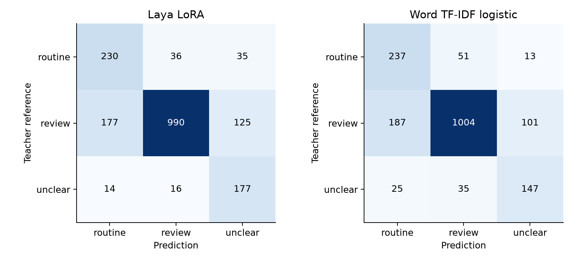
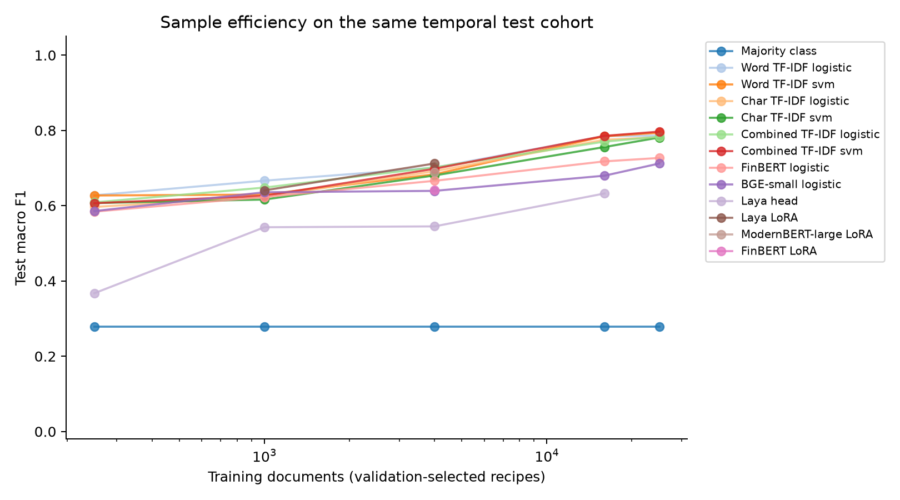
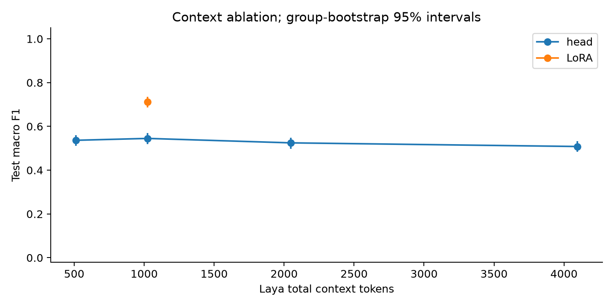
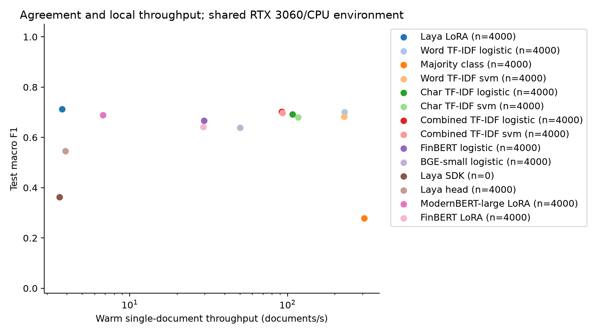
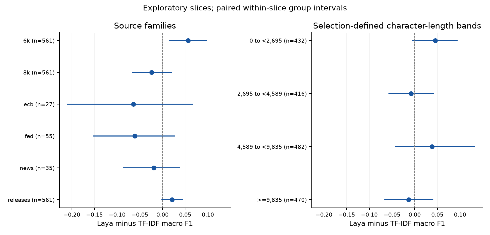
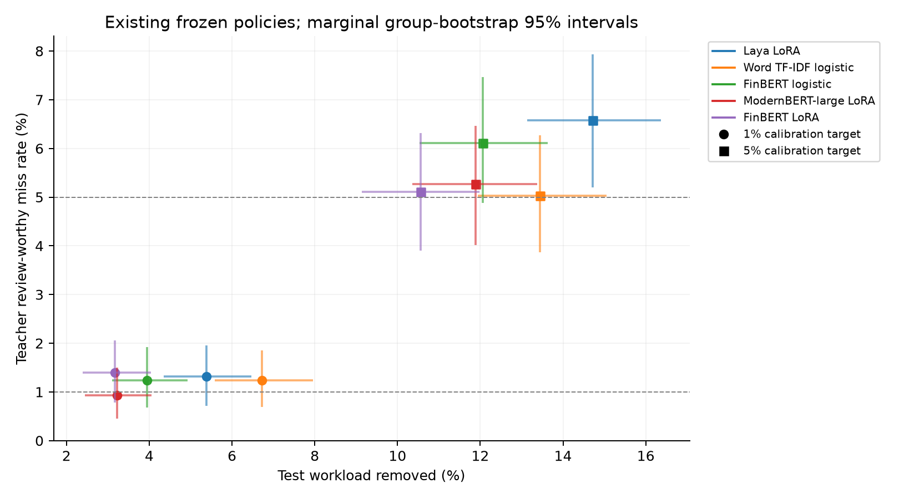

# Financial-document triage across public sources

This test does not resolve a macro-F1 advantage for adapted Laya over the selected linear baseline.

The primary validation-selected contrast is Laya LoRA versus Word TF-IDF logistic. Test macro F1 is 0.712 versus 0.701; paired delta 95% interval [-0.013, 0.036]. These are agreement scores against Luna labels.

Independent audit: Deferred for this version by agreement; 0 resolved and 0 unresolved documents. No claim of analyst usefulness or investment profitability follows from teacher agreement alone.

## Findings and engineering implications

The primary systems have 177 and 187 default critical misses, respectively, among 1292 teacher review-worthy documents. Their warm mean latencies are 267.8 and 4.52 ms on the common selection sample (59.2 times the latency for the decision model). The small observed F1 difference and its interval make a strong lexical baseline essential to the comparison.

Increasing Laya LoRA from 1000 to 4000 training documents raises observed F1 by 0.071; paired 95% interval [0.049, 0.093]. This supports sample efficiency within this fixed recipe and cohort. Changing subset composition and additional selection/calibration labels prevent interpreting it as a universal minimum-data requirement.

FinBERT LoRA has observed F1 0.642 and 306 critical misses, compared with 0.666 and 236 for frozen FinBERT/logistic regression. These are point estimates for the declared recipes, not an exhaustive fine-tuning comparison. Gains over a fresh random triage head alone do not establish that adapters outperform a trained frozen-feature classifier.

The completed head-context ablation does not show that wider context improves every metric. F1 and critical misses need to be read together under the fixed pooling rule. These supplementary comparisons do not justify selecting a new window size on the test cohort.

The primary model's calibration-selected 1%/5% discard rules remove 5.39%/14.72% of the test workload while missing 1.32%/6.58% of teacher review-worthy documents. Calibration targets are empirical constraints, not deployment bounds. The observed rates and support matter more than the target names; confidence alone cannot certify safe automatic discarding.

This bounded study establishes an inspectable end-to-end comparison. Analyst usefulness and commercial-inbox generalization still require independent labels and representative source coverage. Any further recipe or policy selection needs fresh held-out data; the current test is closed to tuning.

## Task and evaluation

The primary contrast and main trained-model tables use 4000 training documents per method. Unadapted references use no task training; larger imported curves are supplementary. Generative LLM adaptation, larger LoRA runs and independent human review are deferred by the user. This is an end-to-end teacher-agreement study, not expert validation of materiality.

Classify supplied source content as routine, review_worthy or unclear for an analyst inbox. No issuer history, portfolio context, future returns or market reaction is supplied. Unclear routes to review. Macro F1 averages all three declared labels, including absent classes in small slices. The critical error is a review-worthy document predicted routine.

The research question is whether supervised decision-model adaptation and larger contiguous context improve triage agreement, critical misses and throughput relative to lexical and encoder baselines. FinBERT's published sentiment results do not establish triage quality; BGE is an embedding model. ModernBERT supplies a backbone-family system comparison; classifier/decision heads and source-window budgets differ. Primary sources and distinctions are documented in [literature.md](https://github.com/LuccaPereiraMartins/systematic-trading/blob/2afc7e45bbc966313c0d86fd0151353e7a34e73d/decision_models/literature.md).

Train ends 2026-03-31; selection/calibration use April-June; test uses July-September. Event and verified near-duplicate groups cannot cross boundaries. Old experimental bodies and near duplicates are excluded from fresh validation/test. Candidate retrieval is approximate and can miss duplicates. Every core recipe, checkpoint, calibration and discard threshold was frozen before test inference.

| Pretrained model | Pinned Hub revision |
| --- | --- |
| BAAI/bge-small-en-v1.5 | 5c38ec7c405ec4b44b94cc5a9bb96e735b38267a |
| ProsusAI/finbert | 4556d13015211d73dccd3fdd39d39232506f3e43 |
| answerdotai/ModernBERT-large | 45bb4654a4d5aaff24dd11d4781fa46d39bf8c13 |
| convaiinnovations/laya | 55cf4c4ebb4ebe31b2550e8bdf3bd21b99753851 |

## Source and label coverage

| Input | Raw documents | Family / provider | Document dates |
| --- | --- | --- | --- |
| 8k.jsonl | 30000 | 8k / sec | 2019-01-02 to 2026-09-30 |
| releases.jsonl | 30000 | releases / sec | 2019-01-02 to 2026-09-30 |
| 6k.jsonl | 25000 | 6k / sec | 2019-01-02 to 2026-09-30 |
| fed.jsonl | 1826 | fed / fed | 2019-01-08 to 2026-09-30 |
| ecb.jsonl | 722 | ecb / ecb | 2019-01-10 to 2026-09-29 |
| news.jsonl | 201 | news / wikinews | 2019-01-05 to 2026-04-15 |
| govuk.jsonl | 1257 | news / govuk | 2019-01-01 to 2026-09-30 |
| dataset.json (legacy) | 10000 | 8k / sec | 2025-10-01 to 2026-09-30 |

Raw acquisition counts precede duplicate quarantine, sampling and labeling. Legacy inputs were previously experimented on and are eligible only for training. SEC dates are filing dates, including release exhibits, and may be later than publication elsewhere. Other sources use original article dates or publication metadata; temporal splits use these recorded document dates at day precision.

| Legacy text formatter | Primary filings reconstructed | Exact old-body matches |
| --- | --- | --- |
| edgartools 5.59.1 | 30000 | 588 |

Offline reconstruction of retained primary HTML links exact old-body hashes across text-extraction formats. These links also quarantine related release exhibits from fresh evaluation. Matching candidates are not additional exclusion counts; their groups enter the exclusion rules below. Canonical model inputs are unchanged.

| Legacy event formatter | Old bodies covered | Verified events | Matching source families |
| --- | --- | --- | --- |
| edgartools 5.59.1 | 10000 | 10000 | 8k: 610, releases: 593 |

Every old body is reproduced exactly from preserved submissions or retained index/primary responses. The resulting filing-event links also quarantine release-only candidates whose parent filing is absent from the new sample. Matching source rows enter the group exclusion rules and are not additional exclusion counts. Evidence hashes and reconstruction methods are recorded with the corpus.

| Family | Exclusion reason | Documents |
| --- | --- | --- |
| 8k | cross boundary group | 555 |
| 8k | previously experimented group | 5132 |
| 6k | cross boundary group | 138 |
| releases | cross boundary group | 10 |
| releases | previously experimented group | 294 |

| Partition | Available after exclusions | Selected before labeling |
| --- | --- | --- |
| train | 87793 | 25000 |
| validation | 2580 | 1200 |
| test | 2504 | 1800 |

Selection applies the recorded split ceilings and train/validation/test 8-K share cap; these counts are distinct from labeled support below.

| Family | Train | Selection | Calibration | Test |
| --- | --- | --- | --- | --- |
| 6k | 7134 | 243 | 111 | 561 |
| 8k | 7068 | 246 | 108 | 561 |
| ecb | 666 | 17 | 12 | 27 |
| fed | 1712 | 44 | 15 | 55 |
| news | 1373 | 38 | 12 | 35 |
| releases | 7047 | 249 | 105 | 561 |

Source shortfalls are not filled by additional 8-Ks. These institutional/public-news cohorts are not a representative commercial inbox. Publication dates and snapshots cannot establish the exact text available at the historical date; pretraining exposure remains possible. Rights and collection methods are documented in [sources.md](https://github.com/LuccaPereiraMartins/systematic-trading/blob/2afc7e45bbc966313c0d86fd0151353e7a34e73d/decision_models/sources.md).

| Split | Documents | routine | review_worthy | unclear |
| --- | --- | --- | --- | --- |
| train | 25000 | 5569 | 16674 | 2757 |
| selection | 837 | 192 | 552 | 93 |
| calibration | 363 | 75 | 252 | 36 |
| test | 1800 | 301 | 1292 | 207 |

| Provider | Train | Selection | Calibration | Test |
| --- | --- | --- | --- | --- |
| ecb | 666 | 17 | 12 | 27 |
| fed | 1712 | 44 | 15 | 55 |
| govuk | 1173 | 37 | 12 | 35 |
| sec | 21249 | 738 | 324 | 1683 |
| wikinews | 200 | 1 | 0 | 0 |

The news family can contain official financial announcements as well as Wikinews. Provider coverage is reported separately; official announcements do not establish commercial-journalism generalization.

| Label queue | Queued | Labeled | Unlabeled | Retained | 8-K cap excluded |
| --- | --- | --- | --- | --- | --- |
| train | 25000 | 25000 | 0 | 25000 | 0 |
| validation | 1200 | 1200 | 0 | 1200 | 0 |
| test | 1800 | 1800 | 0 | 1800 | 0 |

Validation/test labeling must be complete. A budget-limited training queue can retain unlabeled rows; family/error counts remain in the manifest. The 40% primary 8-K cap is checked again on retained labels; cap exclusions remain in the input queue and project spending. Attained sample sizes, rather than collection targets, define the learning curves.

| Label queue | Successful teacher labels | Recorded USD | Cost unavailable |
| --- | --- | --- | --- |
| train | 25000 | 4.3940 | 0 |
| validation | 1200 | 0.1730 | 0 |
| test | 1800 | 0.3178 | 0 |

These costs cover successful teacher annotations retained in the frozen benchmark, using recorded API usage and prices. Missing costs are counted separately. The shared $5 project ledger also covers pilots, failed or unresolved requests and labels excluded from the benchmark; these retained-label totals are not the entire project bill. Human-review time is excluded.

## Model comparisons

| Model | Train | Macro F1 | 95% CI | Misses | Miss rate | Brier |
| --- | --- | --- | --- | --- | --- | --- |
| Laya LoRA | 4000 | 0.712 | [0.686, 0.735] | 177 | 0.137 | 0.300 |
| Word TF-IDF logistic | 4000 | 0.701 | [0.674, 0.726] | 187 | 0.145 | 0.304 |
| Majority class | 4000 | 0.279 | [0.274, 0.284] | 0 | 0.000 | 0.446 |
| Word TF-IDF svm | 4000 | 0.683 | [0.656, 0.709] | 176 | 0.136 | 0.317 |
| Char TF-IDF logistic | 4000 | 0.692 | [0.664, 0.716] | 230 | 0.178 | 0.339 |
| Char TF-IDF svm | 4000 | 0.680 | [0.652, 0.705] | 207 | 0.160 | 0.339 |
| Combined TF-IDF logistic | 4000 | 0.702 | [0.675, 0.727] | 183 | 0.142 | 0.308 |
| Combined TF-IDF svm | 4000 | 0.698 | [0.671, 0.723] | 194 | 0.150 | 0.314 |
| FinBERT logistic | 4000 | 0.666 | [0.641, 0.691] | 236 | 0.183 | 0.368 |
| BGE-small logistic | 4000 | 0.639 | [0.613, 0.664] | 238 | 0.184 | 0.390 |
| Laya SDK | 0 | 0.363 | [0.348, 0.379] | 321 | 0.248 | 0.488 |
| Laya head | 4000 | 0.545 | [0.519, 0.570] | 231 | 0.179 | 0.471 |
| ModernBERT-large LoRA | 4000 | 0.689 | [0.664, 0.713] | 267 | 0.207 | 0.344 |
| FinBERT LoRA | 4000 | 0.642 | [0.616, 0.666] | 306 | 0.237 | 0.428 |

Misses use the default argmax routine decision; the denominator is review-worthy support. Brier sums squared errors over three classes (0-2). Full artifacts include class precision/recall/F1, confusion matrices, accuracy, log loss, ten-bin ECE, source slices and reference provenance. Intervals resample whole related groups 2000 times with shared draws; they condition on the single trained seed and have no multiplicity correction.

| Model | Class | Precision | Recall | F1 | Support |
| --- | --- | --- | --- | --- | --- |
| Laya LoRA | routine | 0.546 | 0.764 | 0.637 | 301 |
| Laya LoRA | review_worthy | 0.950 | 0.766 | 0.848 | 1292 |
| Laya LoRA | unclear | 0.525 | 0.855 | 0.651 | 207 |
| Word TF-IDF logistic | routine | 0.528 | 0.787 | 0.632 | 301 |
| Word TF-IDF logistic | review_worthy | 0.921 | 0.777 | 0.843 | 1292 |
| Word TF-IDF logistic | unclear | 0.563 | 0.710 | 0.628 | 207 |

## Source slices and uncertainty

| Model | Family | Documents | Macro F1 | Review support | Misses |
| --- | --- | --- | --- | --- | --- |
| Laya LoRA | 6k | 561 | 0.740 | 297 | 40 |
| Laya LoRA | 8k | 561 | 0.607 | 413 | 70 |
| Laya LoRA | ecb | 27 | 0.500 | 18 | 3 |
| Laya LoRA | fed | 55 | 0.483 | 40 | 9 |
| Laya LoRA | news | 35 | 0.563 | 25 | 5 |
| Laya LoRA | releases | 561 | 0.530 | 499 | 50 |
| Word TF-IDF logistic | 6k | 561 | 0.684 | 297 | 45 |
| Word TF-IDF logistic | 8k | 561 | 0.631 | 413 | 73 |
| Word TF-IDF logistic | ecb | 27 | 0.564 | 18 | 4 |
| Word TF-IDF logistic | fed | 55 | 0.544 | 40 | 8 |
| Word TF-IDF logistic | news | 35 | 0.582 | 25 | 4 |
| Word TF-IDF logistic | releases | 561 | 0.510 | 499 | 53 |

| Model | Provider | Documents | Macro F1 | Review support | Misses |
| --- | --- | --- | --- | --- | --- |
| Laya LoRA | ecb | 27 | 0.500 | 18 | 3 |
| Laya LoRA | fed | 55 | 0.483 | 40 | 9 |
| Laya LoRA | govuk | 35 | 0.563 | 25 | 5 |
| Laya LoRA | sec | 1683 | 0.712 | 1209 | 160 |
| Word TF-IDF logistic | ecb | 27 | 0.564 | 18 | 4 |
| Word TF-IDF logistic | fed | 55 | 0.544 | 40 | 8 |
| Word TF-IDF logistic | govuk | 35 | 0.582 | 25 | 4 |
| Word TF-IDF logistic | sec | 1683 | 0.693 | 1209 | 171 |

| Model | Log loss | ECE (10 bins) | Median uncertainty |
| --- | --- | --- | --- |
| Laya LoRA | 0.501 | 0.034 | 0.147 |
| Word TF-IDF logistic | 0.502 | 0.028 | 0.158 |
| Majority class | 0.792 | 0.024 | 0.306 |
| Word TF-IDF svm | 0.535 | 0.038 | 0.155 |
| Char TF-IDF logistic | 0.560 | 0.024 | 0.200 |
| Char TF-IDF svm | 0.567 | 0.027 | 0.193 |
| Combined TF-IDF logistic | 0.509 | 0.021 | 0.164 |
| Combined TF-IDF svm | 0.523 | 0.033 | 0.163 |
| FinBERT logistic | 0.605 | 0.015 | 0.266 |
| BGE-small logistic | 0.647 | 0.038 | 0.286 |
| Laya SDK | 0.838 | 0.115 | 0.328 |
| Laya head | 0.781 | 0.041 | 0.359 |
| ModernBERT-large LoRA | 0.560 | 0.018 | 0.207 |
| FinBERT LoRA | 0.692 | 0.042 | 0.280 |

| Model | Raw Brier | Cal. Brier | Raw ECE | Cal. ECE |
| --- | --- | --- | --- | --- |
| Laya LoRA | 0.303 | 0.300 | 0.049 | 0.034 |
| Word TF-IDF logistic | 0.313 | 0.304 | 0.067 | 0.028 |
| Majority class | 0.564 | 0.446 | 0.282 | 0.024 |
| Word TF-IDF svm | 0.321 | 0.317 | 0.056 | 0.038 |
| Char TF-IDF logistic | 0.366 | 0.339 | 0.110 | 0.024 |
| Char TF-IDF svm | 0.338 | 0.339 | 0.029 | 0.027 |
| Combined TF-IDF logistic | 0.338 | 0.308 | 0.111 | 0.021 |
| Combined TF-IDF svm | 0.328 | 0.314 | 0.093 | 0.033 |
| FinBERT logistic | 0.368 | 0.368 | 0.017 | 0.015 |
| BGE-small logistic | 0.397 | 0.390 | 0.067 | 0.038 |
| Laya SDK | 0.486 | 0.488 | 0.110 | 0.115 |
| Laya head | 0.472 | 0.471 | 0.072 | 0.041 |
| ModernBERT-large LoRA | 0.348 | 0.344 | 0.052 | 0.018 |
| FinBERT LoRA | 0.452 | 0.428 | 0.107 | 0.042 |

Raw and calibrated scores use the same test documents. A scalar temperature is fitted on separate calibration groups; it changes confidence and discard behavior while preserving argmax labels. Its use follows [Guo et al.](https://arxiv.org/abs/1706.04599); it does not guarantee calibration on this cohort.

Uncertainty is 1 minus the largest calibrated class probability. It is model confidence, not a probability of investment materiality; teacher self-reported uncertainty is retained separately. Class support must be read beside small-slice macro F1. When no misses are observed, bootstrap resampling cannot reveal unseen errors.

Calibrated uncertainty: Laya LoRA.

| Uncertainty | Documents | Accuracy | Review support | Misses | Miss rate |
| --- | --- | --- | --- | --- | --- |
| [0.00, 0.10) | 696 | 0.954 | 512 | 21 | 0.041 |
| [0.10, 0.20) | 386 | 0.824 | 283 | 34 | 0.120 |
| [0.20, 0.40) | 460 | 0.635 | 321 | 65 | 0.202 |
| [0.40, 1.00] | 258 | 0.477 | 176 | 57 | 0.324 |

Calibrated uncertainty: Word TF-IDF logistic.

| Uncertainty | Documents | Accuracy | Review support | Misses | Miss rate |
| --- | --- | --- | --- | --- | --- |
| [0.00, 0.10) | 706 | 0.963 | 572 | 18 | 0.031 |
| [0.10, 0.20) | 306 | 0.794 | 199 | 37 | 0.186 |
| [0.20, 0.40) | 475 | 0.663 | 314 | 69 | 0.220 |
| [0.40, 1.00] | 313 | 0.479 | 207 | 63 | 0.304 |

Bands are fixed before testing and descriptive, not selected discard thresholds. Boundary values enter the higher band; the final band includes its upper bound. Miss rates divide default review-to-routine misses by review-worthy support within each band. Empty bands and bands without review support have undefined rates, shown as dashes. Three-class uncertainty cannot exceed 2/3; the final band's upper bound covers all valid values.

## Discard policies

| Model | Target | Workload reduction | Misses | Support | Miss rate | Contamination |
| --- | --- | --- | --- | --- | --- | --- |
| Laya LoRA | 0.01 | 0.054 | 17 | 1292 | 0.013 | 0.196 |
| Laya LoRA | 0.05 | 0.147 | 85 | 1292 | 0.066 | 0.336 |
| Word TF-IDF logistic | 0.01 | 0.067 | 16 | 1292 | 0.012 | 0.157 |
| Word TF-IDF logistic | 0.05 | 0.134 | 65 | 1292 | 0.050 | 0.306 |
| Majority class | 0.01 | 0.000 | 0 | 1292 | 0.000 | - |
| Majority class | 0.05 | 0.000 | 0 | 1292 | 0.000 | - |
| Word TF-IDF svm | 0.01 | 0.052 | 10 | 1292 | 0.008 | 0.129 |
| Word TF-IDF svm | 0.05 | 0.119 | 49 | 1292 | 0.038 | 0.262 |
| Char TF-IDF logistic | 0.01 | 0.033 | 10 | 1292 | 0.008 | 0.169 |
| Char TF-IDF logistic | 0.05 | 0.113 | 59 | 1292 | 0.046 | 0.325 |
| Char TF-IDF svm | 0.01 | 0.037 | 12 | 1292 | 0.009 | 0.197 |
| Char TF-IDF svm | 0.05 | 0.090 | 51 | 1292 | 0.039 | 0.346 |
| Combined TF-IDF logistic | 0.01 | 0.061 | 15 | 1292 | 0.012 | 0.156 |
| Combined TF-IDF logistic | 0.05 | 0.115 | 51 | 1292 | 0.039 | 0.271 |
| Combined TF-IDF svm | 0.01 | 0.059 | 16 | 1292 | 0.012 | 0.170 |
| Combined TF-IDF svm | 0.05 | 0.116 | 55 | 1292 | 0.043 | 0.292 |
| FinBERT logistic | 0.01 | 0.039 | 16 | 1292 | 0.012 | 0.225 |
| FinBERT logistic | 0.05 | 0.121 | 79 | 1292 | 0.061 | 0.382 |
| BGE-small logistic | 0.01 | 0.046 | 34 | 1292 | 0.026 | 0.410 |
| BGE-small logistic | 0.05 | 0.088 | 60 | 1292 | 0.046 | 0.377 |
| Laya SDK | 0.01 | 0.006 | 7 | 1292 | 0.005 | 0.800 |
| Laya SDK | 0.05 | 0.074 | 69 | 1292 | 0.053 | 0.744 |
| Laya head | 0.01 | 0.017 | 18 | 1292 | 0.014 | 0.613 |
| Laya head | 0.05 | 0.042 | 48 | 1292 | 0.037 | 0.671 |
| ModernBERT-large LoRA | 0.01 | 0.032 | 12 | 1292 | 0.009 | 0.207 |
| ModernBERT-large LoRA | 0.05 | 0.119 | 68 | 1292 | 0.053 | 0.322 |
| FinBERT LoRA | 0.01 | 0.032 | 18 | 1292 | 0.014 | 0.316 |
| FinBERT LoRA | 0.05 | 0.106 | 66 | 1292 | 0.051 | 0.363 |

Thresholds maximize discarded routine predictions subject to empirical calibration miss targets of 1%/5%. Predicted review-worthy/unclear always escalate. Sparse support and zero observed misses do not establish population guarantees. Test rates, rather than calibration targets, describe the observed deployment tradeoff.

## Adaptation, sample efficiency and context

Training sizes are nested 250/1000/4000/16000/all where attainable. Each neural run restarts from pinned pretrained weights. Deterministic family/label round-robin sampling changes class/source proportions as strata exhaust; the allocation must be considered when interpreting sample efficiency. One training seed is used. The bounded study adds one predeclared 4000-document LoRA recipe each for Laya, ModernBERT and FinBERT, without a new hyperparameter sweep. Imported head recipes were previously selected at 1000/4000; their tuning labels are additional to the stated training size.

| Training documents | Independent groups | routine | review_worthy | unclear |
| --- | --- | --- | --- | --- |
| 250 | 250 | 99 | 100 | 51 |
| 1000 | 999 | 403 | 404 | 193 |
| 4000 | 3991 | 1648 | 1720 | 632 |
| 16000 | 15824 | 5535 | 7987 | 2478 |
| 25000 | 24685 | 5569 | 16674 | 2757 |

| Family | 250 | 1000 | 4000 | 16000 | 25000 |
| --- | --- | --- | --- | --- | --- |
| 6k | 51 | 204 | 861 | 5463 | 7134 |
| 8k | 51 | 202 | 861 | 4136 | 7068 |
| ecb | 34 | 134 | 502 | 666 | 666 |
| fed | 49 | 191 | 631 | 1712 | 1712 |
| news | 32 | 134 | 572 | 1373 | 1373 |
| releases | 33 | 135 | 573 | 2650 | 7047 |

| Provider | 250 | 1000 | 4000 | 16000 | 25000 |
| --- | --- | --- | --- | --- | --- |
| ecb | 34 | 134 | 502 | 666 | 666 |
| fed | 49 | 191 | 631 | 1712 | 1712 |
| govuk | 27 | 109 | 481 | 1173 | 1173 |
| sec | 135 | 541 | 2295 | 12249 | 21249 |
| wikinews | 5 | 25 | 91 | 200 | 200 |

Counts use the exact frozen training subsets shared by all models. Independent groups may contain multiple related documents. These tables describe training allocation; recipe-screening and validation labels are additional.

Laya uses fixed uniform whole-document pooling and 50% overlapping windows; the native SDK reference uses most-confident-window aggregation. CE/Brier objectives are document-level; no chunk labels are invented. Matched pre-update controls separate supervised adaptation from aggregation and k-bit precision changes. FinBERT/BGE/ModernBERT use fresh triage heads; FinBERT's sentiment head is not mapped to triage labels.

Laya's adapted wrapper averages native three-choice window logits. Literal reserved mask tokens are replaced with spaces before formatting. FinBERT/ModernBERT use non-overlapping source windows, average unpadded token states within each window, then uniformly average window vectors before a new LayerNorm/dropout/linear classifier. Frozen FinBERT/BGE baselines normalize the mean of all window vectors for logistic regression; BGE uses CLS rather than mean token states. Lexical baselines process full bodies. These systems differ in tokenization, window overlap and heads, so their differences do not isolate encoder architecture alone. LoRA updates Wqkv in Laya/ModernBERT and query/value projections in FinBERT: rank 8, alpha 16, adapter dropout 0.05.

| Adapted model | Train | Matched-zero F1 | Adapted F1 | Paired gain 95% CI |
| --- | --- | --- | --- | --- |
| Laya LoRA | 4000 | 0.364 | 0.712 | [0.317, 0.377] |
| Laya head | 4000 | 0.364 | 0.545 | [0.151, 0.211] |
| ModernBERT-large LoRA | 4000 | 0.096 | 0.689 | [0.569, 0.617] |
| FinBERT LoRA | 4000 | 0.097 | 0.642 | [0.521, 0.568] |

| Model | Training increment | F1 gain | Paired gain 95% CI |
| --- | --- | --- | --- |
| Majority class | 250 to 1000 | 0.000 | [0.000, 0.000] |
| Majority class | 1000 to 4000 | 0.000 | [0.000, 0.000] |
| Majority class | 4000 to 16000 | 0.000 | [0.000, 0.000] |
| Majority class | 16000 to 25000 | 0.000 | [0.000, 0.000] |
| Word TF-IDF logistic | 250 to 1000 | 0.039 | [0.022, 0.056] |
| Word TF-IDF logistic | 1000 to 4000 | 0.035 | [0.014, 0.056] |
| Word TF-IDF logistic | 4000 to 16000 | 0.084 | [0.061, 0.109] |
| Word TF-IDF logistic | 16000 to 25000 | 0.002 | [-0.013, 0.016] |
| Word TF-IDF svm | 250 to 1000 | 0.002 | [-0.012, 0.017] |
| Word TF-IDF svm | 1000 to 4000 | 0.054 | [0.030, 0.077] |
| Word TF-IDF svm | 4000 to 16000 | 0.101 | [0.079, 0.126] |
| Word TF-IDF svm | 16000 to 25000 | 0.009 | [-0.003, 0.021] |
| Char TF-IDF logistic | 250 to 1000 | 0.027 | [0.013, 0.041] |
| Char TF-IDF logistic | 1000 to 4000 | 0.068 | [0.044, 0.092] |
| Char TF-IDF logistic | 4000 to 16000 | 0.084 | [0.060, 0.109] |
| Char TF-IDF logistic | 16000 to 25000 | 0.007 | [-0.010, 0.024] |
| Char TF-IDF svm | 250 to 1000 | 0.009 | [-0.015, 0.032] |
| Char TF-IDF svm | 1000 to 4000 | 0.064 | [0.034, 0.094] |
| Char TF-IDF svm | 4000 to 16000 | 0.076 | [0.053, 0.100] |
| Char TF-IDF svm | 16000 to 25000 | 0.025 | [0.006, 0.045] |
| Combined TF-IDF logistic | 250 to 1000 | 0.039 | [0.023, 0.056] |
| Combined TF-IDF logistic | 1000 to 4000 | 0.054 | [0.031, 0.077] |
| Combined TF-IDF logistic | 4000 to 16000 | 0.068 | [0.044, 0.093] |
| Combined TF-IDF logistic | 16000 to 25000 | 0.013 | [-0.005, 0.030] |
| Combined TF-IDF svm | 250 to 1000 | 0.019 | [0.004, 0.035] |
| Combined TF-IDF svm | 1000 to 4000 | 0.072 | [0.051, 0.094] |
| Combined TF-IDF svm | 4000 to 16000 | 0.087 | [0.065, 0.112] |
| Combined TF-IDF svm | 16000 to 25000 | 0.011 | [-0.002, 0.024] |
| FinBERT logistic | 250 to 1000 | 0.039 | [0.018, 0.060] |
| FinBERT logistic | 1000 to 4000 | 0.043 | [0.024, 0.063] |
| FinBERT logistic | 4000 to 16000 | 0.052 | [0.030, 0.075] |
| FinBERT logistic | 16000 to 25000 | 0.009 | [-0.014, 0.030] |
| BGE-small logistic | 250 to 1000 | 0.050 | [0.030, 0.070] |
| BGE-small logistic | 1000 to 4000 | 0.004 | [-0.016, 0.021] |
| BGE-small logistic | 4000 to 16000 | 0.040 | [0.019, 0.060] |
| BGE-small logistic | 16000 to 25000 | 0.032 | [0.011, 0.053] |
| Laya head | 250 to 1000 | 0.175 | [0.148, 0.202] |
| Laya head | 1000 to 4000 | 0.002 | [-0.026, 0.028] |
| Laya head | 4000 to 16000 | 0.087 | [0.064, 0.112] |
| Laya LoRA | 1000 to 4000 | 0.071 | [0.049, 0.093] |

| Model | Context tokens | F1 gain | Paired gain 95% CI |
| --- | --- | --- | --- |
| Laya head | 512 to 1024 | 0.009 | [-0.014, 0.031] |
| Laya head | 512 to 2048 | -0.012 | [-0.036, 0.012] |
| Laya head | 512 to 4096 | -0.028 | [-0.052, -0.006] |

Wider Laya windows change contiguous context and the number of votes under the same pooling rule. All encoded source tokens after tokenizer/reserved-token normalization remain covered at each context size; the difference is not previously omitted text.

These paired differences describe this fixed-seed cohort. Additional tuning labels and multiple comparisons limit claims about minimum data requirements or statistical significance.

## Latency and cost

| Model | P50 s | P95 s | Batch 1 docs/s | Batch 8 docs/s | Peak VRAM GiB |
| --- | --- | --- | --- | --- | --- |
| Laya LoRA | 0.144 | 1.128 | 3.737 | 3.737 | 2.11 |
| Word TF-IDF logistic | 0.004 | 0.008 | 229.703 | 678.769 | 0.00 |
| Majority class | 0.003 | 0.003 | 305.830 | 2918.410 | 0.00 |
| Word TF-IDF svm | 0.004 | 0.008 | 228.751 | 661.454 | 0.00 |
| Char TF-IDF logistic | 0.006 | 0.023 | 107.762 | 180.121 | 0.00 |
| Char TF-IDF svm | 0.006 | 0.023 | 116.543 | 179.075 | 0.00 |
| Combined TF-IDF logistic | 0.007 | 0.029 | 92.004 | 143.477 | 0.00 |
| Combined TF-IDF svm | 0.007 | 0.029 | 92.816 | 141.649 | 0.00 |
| FinBERT logistic | 0.021 | 0.109 | 29.642 | 33.083 | 0.51 |
| BGE-small logistic | 0.015 | 0.054 | 50.057 | 61.110 | 0.18 |
| Laya SDK | 0.149 | 1.086 | 3.595 | 3.584 | 4.07 |
| Laya head | 0.137 | 1.065 | 3.928 | 3.923 | 2.09 |
| ModernBERT-large LoRA | 0.072 | 0.525 | 6.771 | 6.798 | 1.81 |
| FinBERT LoRA | 0.020 | 0.118 | 29.323 | 29.558 | 0.52 |

Warm timings include preprocessing and all model windows, exclude loading, and use a fixed 128-document selection sample on a shared machine. Sklearn batches are native; neural/SDK/prompt document batches are serial, with window batching where supported. Local API charges are zero; hardware, electricity and collection are additional.

| Model | Fit elapsed s | Trainable neural M | Training VRAM GiB | Original weights GiB | Saved checkpoint MiB |
| --- | --- | --- | --- | --- | --- |
| Laya LoRA | 13962.5 | 27.166 | 3.18 | - | 311.15 |
| Word TF-IDF logistic | 38.6 | - | 0.00 | - | 6.22 |
| Majority class | 0.1 | - | 0.00 | - | 0.00 |
| Word TF-IDF svm | 52.0 | - | 0.00 | - | 6.22 |
| Char TF-IDF logistic | 109.7 | - | 0.00 | - | 5.57 |
| Char TF-IDF svm | 270.5 | - | 0.00 | - | 5.57 |
| Combined TF-IDF logistic | 139.0 | - | 0.00 | - | 11.79 |
| Combined TF-IDF svm | 354.4 | - | 0.00 | - | 11.79 |
| FinBERT logistic | 32.7 | - | 0.00 | 0.41 | 0.03 |
| BGE-small logistic | 12.4 | - | 0.00 | 0.12 | 0.01 |
| Laya SDK | 0.0 | - | 0.00 | - | 0.00 |
| Laya head | 7160.4 | 26.248 | 2.35 | - | 300.59 |
| ModernBERT-large LoRA | 7813.7 | 0.923 | 2.88 | 1.47 | 10.79 |
| FinBERT LoRA | 1958.6 | 0.299 | 0.78 | 0.41 | 3.65 |

Fit elapsed includes training/grid selection and recorded validation work; cached features can reduce elapsed time. Neural trainable counts include heads and adapters. Equal LoRA rank does not imply equal updated parameter budgets: Laya also trains its larger native decision head. Counts for linear classifiers are not recorded in this column. Original weights are cached pretrained input files, not packed deployment size. Saved checkpoints may include optimizer/RNG state. Peak VRAM is torch-allocated memory, excluding driver/display overhead; the latency table reports inference peak, with training peak listed separately.

| Model | Feature documents | Recorded compute s | Feature peak GiB | Cache reused |
| --- | --- | --- | --- | --- |
| FinBERT logistic | 5200 | 157.1 | 0.51 | 5200 |
| BGE-small logistic | 5200 | 85.7 | 0.18 | 5200 |

Frozen-feature counts include train, selection and calibration. Recorded compute sums each requested document's original preprocessing/encoder time under the pinned recipe; it excludes model loading and cache I/O. Cached rows retain this measurement when reused across sample sizes. Fit elapsed includes only preparation performed during that fit. These timings describe the shared machine, not a new cold run.

## Critical-error inspection

Routine probability 0.993; 2026-07-01; releases; [source](https://www.sec.gov/Archives/edgar/data/1838987/000121390026073995/ea029660301ex99-1.htm). Teacher label: review_worthy. Body hash: 0d3834cf8f28a6d0739cad71e75a30257ccda1dfb5ed267e15f02aeb30d7b2e9.

Exhibit 99.1 SunPower Closes $10 Million Share Exchange OREM, Utah (July 1, 2026) – SunPower Inc. (“SunPower,” the “Company,” or Nasdaq: “SPWR”), a solar technology, ...

Routine probability 0.992; 2026-07-09; fed; [source](https://www.federalreserve.gov/newsevents/pressreleases/monetary20260709a.htm). Teacher label: review_worthy. Body hash: 1b719fccf4a881f128158f176db03990a19fb1a4691b437b11575a6f50262801.

July 09, 2026 Federal Reserve announces the leadership and objectives of its task forces to advance the conduct of monetary policy For release at 3:00 ...

Routine probability 0.991; 2026-07-28; releases; [source](https://www.sec.gov/Archives/edgar/data/17843/000119312526320951/d115412dex991.htm). Teacher label: review_worthy. Body hash: 6dc565847109e454abd0548bed4c106ecae9928e51eb97fc0bd3ac47b2e2f3ad.

Exhibit 99.1 CARPENTER TECHNOLOGY ANNOUNCES THE PASSING OF BRIAN MALLOY TONY THENE TO RETURN TO CEO ROLE EFFECTIVE IMMEDIATELY PHILADELPHIA, July 27, 2026 (GLOBE NEWSWIRE) ...

Routine probability 0.988; 2026-09-02; releases; [source](https://www.sec.gov/Archives/edgar/data/47111/000162828026060131/exhibit991-pressreleasedat.htm). Teacher label: review_worthy. Body hash: 3addec01a59c450f3327de57f7457c0437d24e394997eb53d7429142e14e8547.

Exhibit 99.1 FINANCIAL CONTACT: MEDIA CONTACT: Anoori Naughton Allison Kleinfelter anaughton@hersheys.com akleinfelter@hersheys.com The Hershey Company Names Dave Hulays Chief Financial Officer Hulays Succeeds Steve Voskuil, ...

Routine probability 0.985; 2026-09-08; releases; [source](https://www.sec.gov/Archives/edgar/data/1549346/000114036126035918/ef20081694_ex99-1.htm). Teacher label: review_worthy. Body hash: 5f0d2e0dae7a770464b15824dfc772963cb6633a7bc57586cd35244f85cd7823.

Exhibit 99.1 Shutterstock Appoints Three Accomplished Business Leaders to Board of Directors Timothy Adams, Matthew Salzberg, and Michael Thompson bring extensive financial, operational, investment and ...

Routine probability 0.976; 2026-09-18; releases; [source](https://www.sec.gov/Archives/edgar/data/1837671/000183767126000078/cptexhibit993sep26-jcpfs.htm). Teacher label: review_worthy. Body hash: 0eadd9c1aa56af64b24bbb86d986ed263ea5f3ae7a7522794a53ccb22b745e52.

Exhibit 99.3 FOR IMMEDIATE RELEASE September 18, 2026 Copper Property CTL Pass Through Trust Releases Q2-2026 Penney Intermediate Holdings LLC Financial Statements and Master Lease ...

Routine probability 0.973; 2026-08-24; releases; [source](https://www.sec.gov/Archives/edgar/data/1378140/000149315226039793/ex99-2.htm). Teacher label: review_worthy. Body hash: 2f7e803ea19f2ebabd62406578ce98b2ced39f4244ed9659d1c88bfc24842374.

Exhibit 99.2 Ocean Power Technologies, Inc. Provides Required Disclosure MONROE TOWNSHIP, N.J., Aug. 21, 2026 (GLOBE NEWSWIRE) — Ocean Power Technologies, Inc. (“OPT” or the ...

Routine probability 0.970; 2026-07-07; releases; [source](https://www.sec.gov/Archives/edgar/data/1843714/000168316826005316/zapata_ex9901.htm). Teacher label: review_worthy. Body hash: 444123abdd397d23d43ae9b70035d42fdb85592791182721b2b3461e64401e62.

Exhibit 99.1 Zapata Quantum to Present at the Global Technology Virtual Investor Conference July 9th CEO Sumit Kapur will discuss highlights including the Company's NVIDIA ...

Error examples are selected after testing for inspection, not model tuning. Labels may be wrong; analyst usefulness needs independent review. All miss identities and model disagreements remain inspectable in results.json.

## Reproducibility and limits

The serial runner stores failed/OOM configurations, any window-batch fallback, selected recipes, pinned model revisions, library versions, source snapshots, RNG/optimizer checkpoints, dataset/subset hashes and an immutable pre-test freeze. Reproduce with the locked dependencies and study.py --stage all; existing runs resume with changed-artifact guards. Raw-source rights/attribution travel with the corpus. Old API/container behavior remains separate.

This is source-only inbox triage on constrained public cohorts, not expert materiality assessment or a trading strategy. One seed cannot quantify training instability. Bootstrap intervals quantify cohort sampling only. Teacher labels favor agreement with the labeling approach; independent audit availability is stated above. Missing source/date coverage, approximate duplicate retrieval and pretraining exposure restrict generalization. No paid SOTA comparison or RL/RLCD result is claimed. RL/RLCD remains a possible follow-on after the core study.

## Exploratory diagnostics added after the primary results

The following questions were added after inspecting the primary held-out results. They are descriptive, not prespecified hypotheses, new model choices or tuned discard rules. The original primary comparison and its conclusion remain unchanged. Intervals condition on one trained seed and have no multiplicity adjustment.

Approximately 68.3% of the observed macro-F1 point difference comes from the unclear class. Each class contributes its F1 difference divided by three; source-family F1 scores cannot be added this way. The contribution intervals all include zero. This decomposition is not a causal attribution or a resolved class-specific gain.

| Class | Class F1 difference | Contribution to macro-F1 difference | Contribution 95% CI |
| --- | --- | --- | --- |
| routine | 0.0051 | 0.0017 | [-0.010, 0.013] |
| review_worthy | 0.0053 | 0.0018 | [-0.004, 0.007] |
| unclear | 0.0225 | 0.0075 | [-0.008, 0.022] |

Both review-worthy and unclear predictions route to an analyst. The derived two-class view below collapses those existing actions, without changing a prediction. Its numerical scale and meaning differ from the original three-class endpoint; it does not replace it.

| Model | Routing macro F1 | 95% CI | Review misses | Review support | Unclear discarded | Workload removed |
| --- | --- | --- | --- | --- | --- | --- |
| Laya LoRA | 0.773 | [0.748, 0.796] | 191 | 1499 | 14 | 0.234 |
| Word TF-IDF logistic | 0.768 | [0.742, 0.791] | 212 | 1499 | 25 | 0.249 |

Paired routing-F1 difference interval: [-0.018, 0.028]. Laya routes 28 additional documents for review in this cohort. Its lower point count of required-review misses therefore comes with additional workload; neither a routing-F1 nor a miss-rate advantage is resolved by these intervals.

### Shared and model-specific critical misses

| Critical-miss pattern | Documents |
| --- | --- |
| Both models | 105 |
| Laya only | 72 |
| TF-IDF only | 82 |
| Neither model | 1033 |

These four cells partition 1292 teacher review-worthy documents. Overall three-class prediction agreement is 79.56%. Complementary errors motivate a future ensemble/cascade study, but these counts omit its false-positive, workload and compute tradeoffs. They do not measure a new deployed policy. Any such policy needs validation selection and fresh test data. Common misses cannot distinguish student errors from questionable teacher references without independent review.

### Source and document-length differences

Dots are Laya minus TF-IDF point differences; bars are paired 95% intervals from 2,000 whole-group resamples within each slice. Length bands use character-count quartiles from the 837-document selection cohort, chosen mechanically for this post-hoc analysis. Their cutpoints are 2,695, 4,589, 9,835 characters. Test bands need not have equal counts. Character lengths are not model token counts. Source and length overlap, so these slices do not isolate a causal effect of context or architecture.

| Family | Documents | Routine | Review-worthy | Unclear | Fixed-label F1 ceiling |
| --- | --- | --- | --- | --- | --- |
| 6k | 561 | 105 | 297 | 159 | 1.000 |
| 8k | 561 | 100 | 413 | 48 | 1.000 |
| ecb | 27 | 9 | 18 | 0 | 0.667 |
| fed | 55 | 15 | 40 | 0 | 0.667 |
| news | 35 | 10 | 25 | 0 | 0.667 |
| releases | 561 | 62 | 499 | 0 | 0.667 |

All slice scores retain the three declared labels. A slice without unclear references has a maximum possible macro F1 of 2/3 under this definition, not one. Compare models within the same slice; raw scores across families have different label support and attainable ceilings. The 6-K slice has the largest positive point difference; its nominal interval excludes zero. This exploratory, uncorrected comparison does not establish universal source superiority. All four length-band intervals include zero, including the longest band.

### Uncertainty around the frozen discard rules

Circles/squares identify the original 1%/5% calibration targets. Dashed lines show those targets, not deployment guarantees. Horizontal and vertical bars are separate marginal 95% group intervals, not joint confidence regions. These points and intervals reuse the original frozen policies and statistics; no threshold sweep, ensemble or model selection was performed.

| Calibration target | Workload-difference 95% CI (pp) | Critical-miss-rate difference 95% CI (pp) |
| --- | --- | --- |
| 0.01 | [-2.50, -0.22] | [-0.61, 0.78] |
| 0.05 | [-0.22, 2.67] | [0.08, 2.90] |

Differences are Laya minus TF-IDF. More workload removed is favorable; a higher critical-miss rate is unfavorable. At the 1% target, Laya removes less workload and the miss-rate difference is unresolved. At the 5% target, its nominal interval indicates more teacher review-worthy misses while the workload difference remains unresolved. These conditional, uncorrected comparisons help interpret the existing systems; they are not permission to choose a new operating rule from this test set.

## Development-only FinBERT sample-efficiency extension

After the original held-out results were inspected, the user authorized one additional fixed-recipe FinBERT LoRA fit at 16,000 training documents. This section uses train, selection and calibration only. It is not a 65th held-out comparison and does not revise the frozen primary result. A new held-out comparison requires fresh data. Selection scores choose the checkpoint and are optimistic fitting evidence; calibration scores also use fitting data. No significance or generalization claim follows.

Both sizes start from the same pinned FinBERT weights and identical initial task-head parameters. The recipe stays fixed: context 512, rank 8, alpha 16, dropout 0.05, unweighted cross-entropy, learning rate 0.0001 for head and adapters, seed 42 and three epochs. Epoch zero remains eligible; both sizes select epoch three. Pooling, source coverage and the 837-selection/363-calibration cohorts are unchanged. There is no new learning-rate or seed sweep.

| Training docs | Selection F1 | Critical misses / 552 | Unclear discarded / 93 | Default discards / 837 | Calibration F1 |
| --- | --- | --- | --- | --- | --- |
| 4000 | 0.6715 | 132 | 5 | 286 | 0.6542 |
| 16000 | 0.7636 | 67 | 17 | 242 | 0.8058 |

Selection macro F1 increases by 0.0921; teacher review-worthy misses fall from 132 to 67. Default discards fall by 44, adding review workload, while discarded unclear references increase from five to seventeen. The joint pattern is more informative than F1 alone. These development signals justify a fresh evaluation; they do not establish a new test-set winner.

### Training composition and measured resources

| Training docs | Routine | Review-worthy | Unclear | Raw characters |
| --- | --- | --- | --- | --- |
| 4000 | 1648 | 1720 | 632 | 31,526,200 |
| 16000 | 5535 | 7987 | 2478 | 146,195,420 |

| Family | 4k documents | 16k documents |
| --- | --- | --- |
| 6k | 861 | 5463 |
| 8k | 861 | 4136 |
| ecb | 502 | 666 |
| fed | 631 | 1712 |
| news | 572 | 1373 |
| releases | 573 | 2650 |

The 4k subset is an ordered prefix of the 16k subset, but source/class proportions change as smaller strata exhaust. Three epochs also mean 1,500 versus 6,000 optimizer steps. More documents, more updates and different composition change together; two points cannot establish a minimum label requirement or isolate the cause of the gain. Both fits additionally use 1,200 selection/calibration labels beyond their stated training size.

| Training docs | Train/validation min | Train peak GiB | Warm mean ms | Warm P95 ms | Inference peak GiB |
| --- | --- | --- | --- | --- | --- |
| 4000 | 32.6 | 0.78 | 33.94 | 117.61 | 0.52 |
| 16000 | 143.1 | 0.79 | 34.02 | 117.07 | 0.52 |

The recorded train/validation clock grows 4.38 times; warm mean latency is approximately unchanged on the identical 128-document timing sample. Same-recipe inference cost does not scale with the number of training examples. Loading and final calibration/resource work are excluded from the training clock; the extension controller records 2.41 hours overall. The controller finished normally and released its temporary awake guard before the deadline. No cloud jobs, paid calls or additional fits ran.

### Calibrated policies on development cohorts

Thresholds are fitted on the 363-document calibration cohort. The last three columns show selection results, including discarded unclear references. Targets concern review-worthy misses, rather than all documents requiring review.

| Training docs | Target | Cal. discards / 363 | Cal. misses / 252 | Selection discards / 837 | Selection misses / 552 | Unclear discarded |
| --- | --- | --- | --- | --- | --- | --- |
| 4000 | 0.01 | 10 | 2 | 45 | 12 | 0 |
| 4000 | 0.05 | 42 | 12 | 120 | 44 | 1 |
| 16000 | 0.01 | 26 | 2 | 63 | 8 | 0 |
| 16000 | 0.05 | 52 | 12 | 133 | 21 | 4 |

The 16k 1% policy misses eight of 552 teacher review-worthy selection references (1.45%), exceeding its empirical calibration target. Its 5% policy misses 21 (3.80%), while also discarding four unclear references. Target satisfaction on a fitting cohort is not a population guarantee. Policies were fitted on calibration alone; no rule was chosen using the original test outcomes.

Independent verification checks ordered cohorts and nested training identities, source/runtime fingerprints, finite zero/best/final checkpoints, matched initialization, raw and calibrated arithmetic, calibration temperature and maximal feasible policies, selected epoch, timing sample and resource clocks. The completed 16k checkpoint was replayed on development cohorts only. The original study/result/ownership hashes remain unchanged. Published development probabilities, training metadata, decisions, histories and verifier receipts support CPU arithmetic replay without corpus bodies or model weights.
